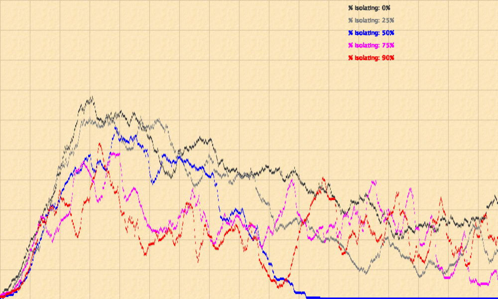

# Epidemic Simulation: does self-isolation flatten the curve?

An agent-based **SIR epidemic simulation** written in Java with [Greenfoot](https://www.greenfoot.org/).
Three hundred people wander a 1000×600 world, bump into each other and pass on an infection, while hospitals,
ambulances, vaccinators and quarantine houses try to slow it down.

The simulation runs **one experiment by itself**: five back-to-back runs where 0%, 25%, 50%, 75% and 90% of
people are willing to self-isolate. Each run's infected curve is drawn onto the background in its own colour,
so at the end you can compare them directly.

## The question

When more people agree to isolate, does the epidemic peak get **lower** and **later**?

| Run | People willing to isolate | Curve colour |
|---|---|---|
| 1 | 0% | dark grey |
| 2 | 25% | grey |
| 3 | 50% | blue |
| 4 | 75% | magenta |
| 5 | 90% | red |

The live SIR chart (bottom left) and the info panel (top left) show susceptible, infected and immune counts,
the peak so far, and an estimate of R.

## What one full experiment looked like



*Each curve is one run: number of infected people (vertical, 2 px per person) over simulation cycles
(horizontal, 1 px per cycle), out of 301 people.*

*This screenshot was taken before a fix to the waning-immunity rate (it ran at 0.3% per cycle instead of the
intended 0.1%). That rule only starts at cycle 800, so the peaks below are unaffected; only the last part of
each curve would look slightly different now.*

Peaks read off this screenshot (approximate, ±5 people):

| Willing to isolate | Peak infected | Share of population |
|---|---|---|
| 0% | ≈ 198 | ≈ 66% |
| 25% | ≈ 180 | ≈ 60% |
| 50% | ≈ 171 | ≈ 57% |
| 75% | ≈ 145 | ≈ 48% |
| 90% | ≈ 155 | ≈ 51% |

What this run suggests, and what it does not:

- From 0% to 75% the peak falls steadily, by roughly a quarter. That is the "flatten the curve" effect.
- 90% did **not** beat 75%. With a single run per setting, that difference is within what randomness alone
  can produce, so it says nothing either way.
- In the 50% run the infection **died out** completely around cycle 600; in the others it settled into an
  endemic level. Whether that is a property of 50% or luck would also need repeated runs to tell.

## How the model works

**People** (`Person`)
- Start *susceptible*. One "patient zero" starts infected in the centre.
- 30% are **high risk**: they catch the infection with 90% probability on contact (50% for everyone else)
  and take twice as long to recover.
- 10% walk around with a **child** (`Child`), who follows them, is smaller and recovers in half the time.
- People who are willing to isolate head for the nearest quarantine house with free space once the outbreak is
  big (more than 70 infected) **or** still growing (estimated R > 1), and come back out when it calms down.
  Susceptible people go to a *rumah karantina* (capacity 30), infected people to a *rumah isolasi* (capacity 10).

**Health care**
- **Hospitals** (capacity 30 each) treat infected people nearby. After treatment, 30% leave immune and 70% leave
  susceptible again.
- **Ambulances** come in three kinds that share one abstract parent: horizontal zig-zag, vertical zig-zag, and a
  *smart* one that chases the nearest untreated infected person. A new smart ambulance is dispatched every
  time the number of infected crosses another multiple of 50.
- **Vaccinators** immunise susceptible people directly. Each carries 5 doses, pauses briefly after every shot,
  and walks back to a hospital to restock when empty (a small state machine: `NORMAL → MENUJU_RS → RESUPPLY`).

**Waning immunity.** After cycle 800, every immune person has a small chance each cycle of becoming susceptible
again, so the system drifts toward an endemic equilibrium instead of dying out completely.

## Object-oriented design

```
            «interface» Movable
                    ▲
          «abstract» Ambulance  ◄── Person finds any ambulance polymorphically
          ▲          ▲            ▲
   ZigZagHorizontal  ZigZagVertikal  SmartPathfinding

   Person ◄── Child                «abstract» QuarantineBuilding
                                          ▲              ▲
                                   RumahKarantina   RumahIsolasi

   enums: InfectionStatus (S/I/R + sprite), Direction, VaccinatorState
```

Every class carries Javadoc that explains *why* it behaves the way it does, not only what it does.

## Running it

1. Install [Greenfoot](https://www.greenfoot.org/download) (free).
2. Clone this repository and open the folder in Greenfoot (*Scenario → Open*).
3. Press **Compile**, then **Run**. The five runs play one after another and the simulation stops by itself.

## Notes and limitations

- **"R0" in the chart is a running estimate**: the average number of people infected by everyone who has recovered
  so far. Because it is measured while the epidemic is under way, it is closer to an effective reproduction
  number than to the textbook R0, which assumes a fully susceptible population.
- One run per setting means the curves include a lot of randomness. A fair comparison would repeat each
  setting many times and compare the averages.
- Code comments and some class names are in Indonesian.

## Assets

`doctor.png` and `hospital.png` are original drawings made for this repository. The other images come from
Greenfoot's built-in image library.
